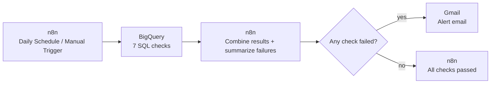
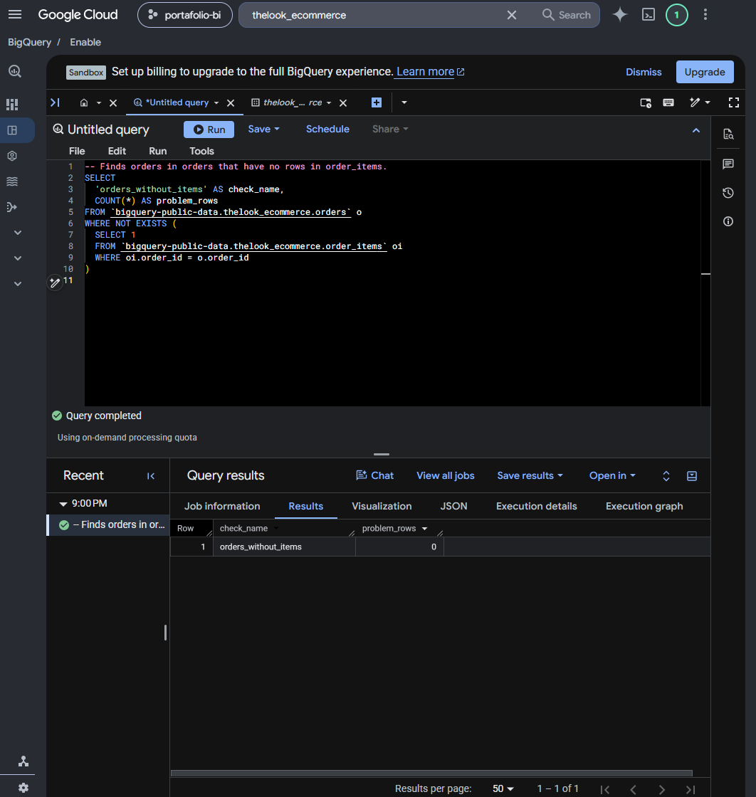
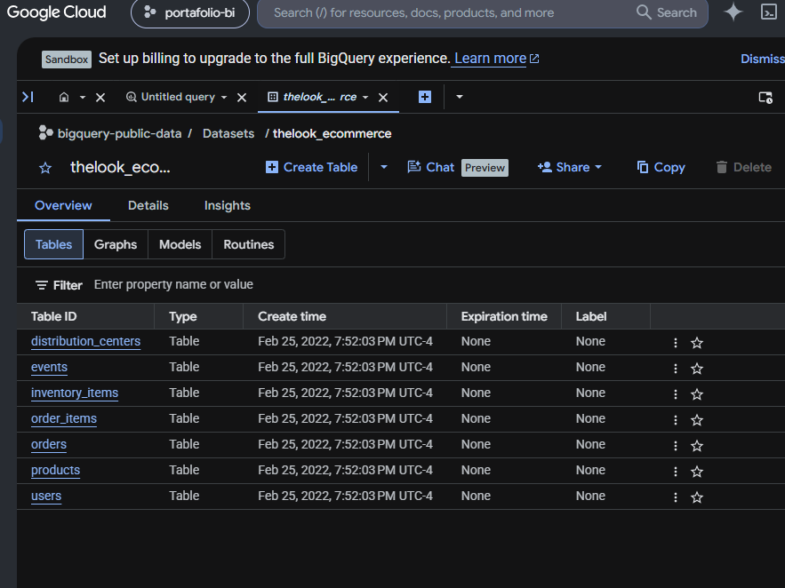
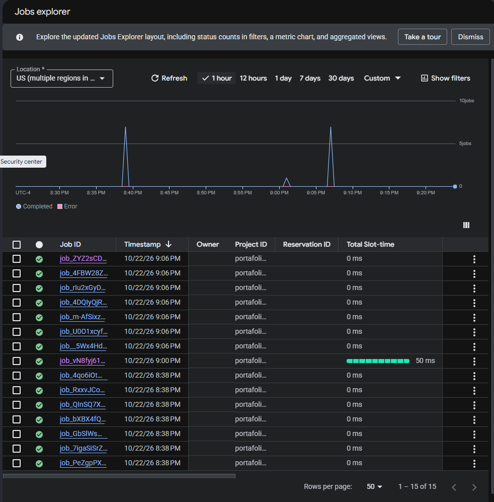
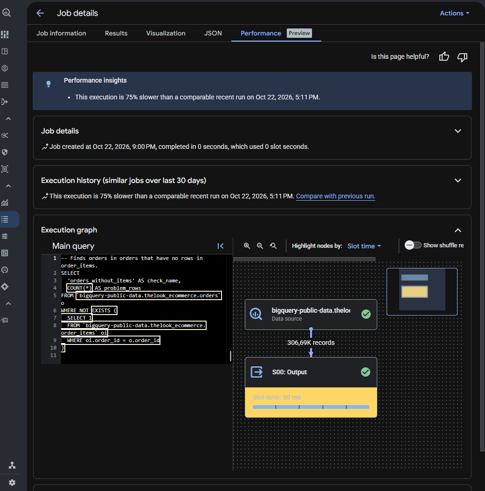
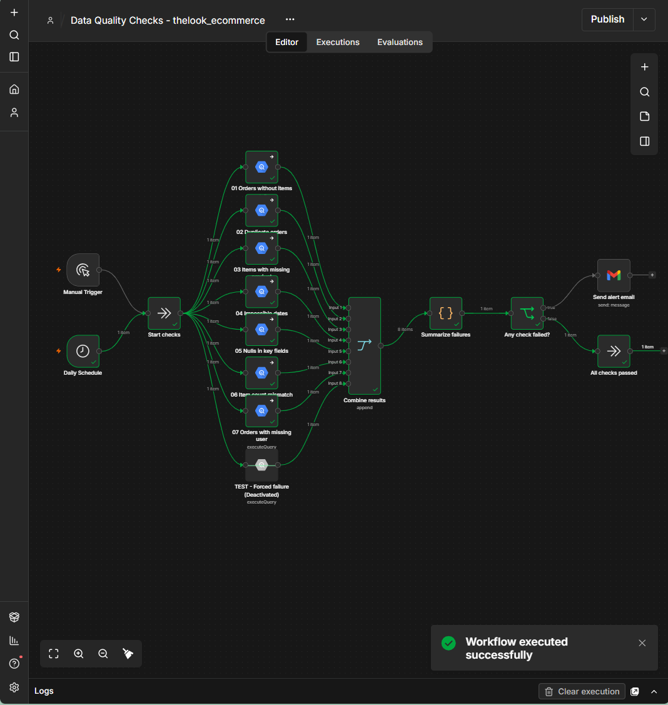
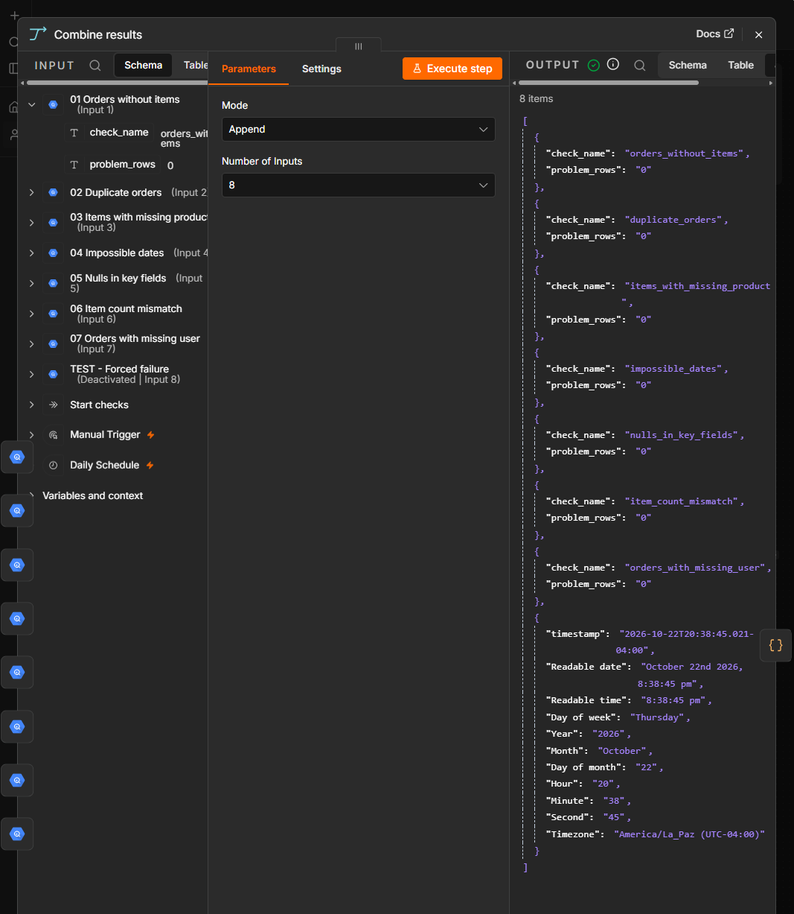
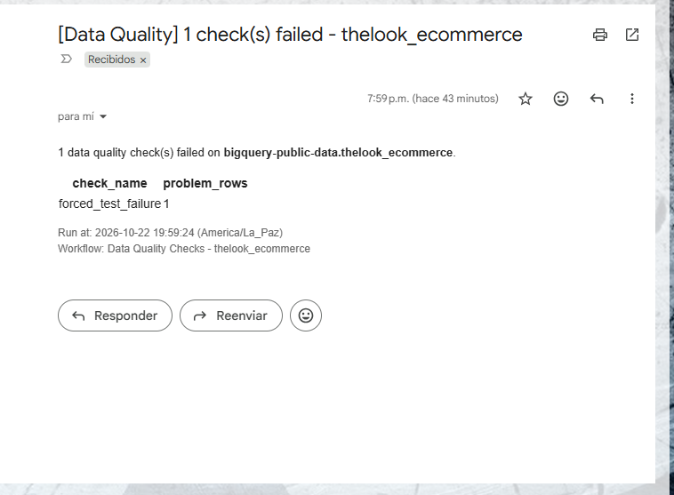

# Data Quality Pipeline — thelook_ecommerce

## Overview
This project runs a daily data quality review on a public e-commerce dataset.
The data lives in the public BigQuery dataset `bigquery-public-data.thelook_ecommerce`.
My own BigQuery project runs seven SQL checks on it. They look for broken relationships, duplicates, impossible dates and missing values.
If any check fails, n8n sends an alert email through Gmail.

## Stack
- **BigQuery** — standard SQL
- **n8n 2.44.5** — running in Docker
- **Gmail API** — with OAuth
- **Claude Code** — AI-assisted development

Built and tested with n8n 2.44.5.

## Architecture



## Where BigQuery fits
The data is in the public BigQuery dataset `bigquery-public-data.thelook_ecommerce`, not in my project.
My BigQuery project runs the 7 SQL checks on that dataset.
n8n only orchestrates them: it starts the queries, collects the results and decides whether to send an alert.
All the queries are in [`sql/`](sql/).


*The `orders_without_items` check running in the BigQuery console, with its result.*


*The tables of the `thelook_ecommerce` dataset.*


*Seven jobs, one per check, within the same minute the workflow ran.*


*The execution graph of the `orders_without_items` check in BigQuery.*

## Checks

| File | What it detects |
|---|---|
| `01_orders_without_items` | Orders in `orders` with no rows in `order_items`. |
| `02_duplicate_orders` | Rows in `orders` that repeat an existing `order_id`. |
| `03_items_with_missing_product` | Items with a non-null `product_id` that does not exist in `products`. |
| `04_impossible_dates` | Orders shipped before creation, delivered before shipping, or returned before delivery. |
| `05_nulls_in_key_fields` | Nulls in key fields of `orders` (`order_id`, `user_id`, `status`, `created_at`) and `order_items` (`id`, `order_id`, `product_id`, `sale_price`). |
| `06_item_count_mismatch` | Orders whose `num_of_item` does not match the actual number of items in `order_items`. |
| `07_orders_with_missing_user` | Orders with a non-null `user_id` that does not exist in `users.id`. |

## How I built it
I built this project with Claude Code as an AI assistant.

**What I decided:**
- The scope: one dataset, scheduled SQL checks and an email alert.
- The design of the workflow and which checks to run.
- The safety limits: no credentials in the repository, read-only work until I confirmed each step, and a cost limit on every query.

**What the AI did:**
- It wrote the SQL checks and the n8n workflow.
- It ran the queries and verified the results with me before each change.

**How I verified the checks:**
- **Control queries.** A check that always returns 0 could be broken. So I ran control queries for six of the seven checks: the opposite version of checks 01 to 04 (for example, orders that do have items), a sensitivity test for check 06 and a null count for check 05. These queries returned large numbers. This shows that the checks can find rows when they exist. Check 07 has no control query yet.
- **An observation in the data.** 19 orders were shipped at the exact same moment they were created. I do not count this as an error, because the `impossible_dates` check uses a strict `<`.
- **Text to number.** BigQuery returns `problem_rows` as text in n8n. The workflow converts it to a number before it compares it with 0.
- **Cost limit.** Every query has a Maximum Bytes Billed limit of 100 MB.
- **Error handling.** The workflow is designed so that if a query fails, the alert names the failing check, for example `query_error: 03 Items with missing product`.
- **Alert test.** The workflow has a test branch that forces a failure. I turned it on to check that the alert email arrives.


*The full workflow in n8n after a run, with the test branch deactivated.*


*The `Combine results` node with the output of the seven checks.*


*The alert email sent by the forced test failure.*

## Limitations
- The dataset is public and synthetic. Its numbers can change between queries.
- BigQuery runs in sandbox mode.
- n8n runs locally in Docker.
- The workflow is not scheduled in production.
- The test branch is deactivated by default.

## Setup
1. In n8n, import [`n8n/data_quality_checks.json`](n8n/data_quality_checks.json).
2. Create your own BigQuery and Gmail credentials in n8n.
3. Assign them in each BigQuery node and in the Gmail node. The file keeps the credential names, but not the credential IDs.
4. In the `Send alert email` node, change the recipient `alerts@example.com` to your own address.
5. Optional: activate the `TEST - Forced failure` node and run the workflow to test the alert. Deactivate it again afterwards.

## Project structure
```
.
├── README.md
├── docs/   # screenshots
├── n8n/    # exported workflow (JSON)
└── sql/    # the 7 data quality checks
```
